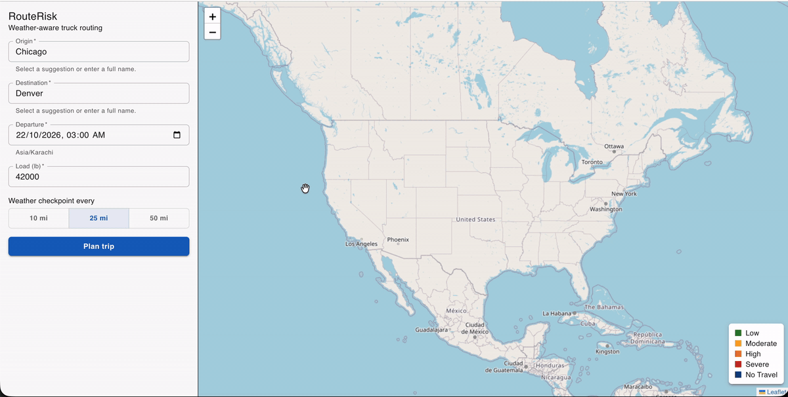

# RouteRisk

Weather-aware truck routing. Enter a trip and RouteRisk finds up to three routes, checks the forecast at each point
the truck will reach and when it gets there, and recommends the safest route, balancing weather risk against travel time.

## Live demo

- **App:** https://routerisk-web.onrender.com
- **API health check:** https://routerisk-api.onrender.com/api/health

The demo runs on Render's free tier, so the server sleeps when idle and the first request can take about a minute.



> **Proof of concept, not a safety system.** Routes, forecasts and risk levels are estimates. Always follow official
> road and weather advisories.

## Features

- Up to 3 route options between two places (typed, or picked from type-ahead suggestions)
- Weather checkpoints every 10, 25 or 50 miles, using the forecast for the hour the truck reaches each one
- Risk from wind, rain and snow, with stricter wind limits for heavier loads
- Routes ranked by No Travel, Severe and High miles, then average risk, then travel time
- Map with routes coloured by risk, checkpoint details, a 0–48 hour weather heatmap and a truck marker per route

## Tech stack

| Part       | Technology                                             |
| ---------- | ------------------------------------------------------ |
| Backend    | Python 3.12, Django 6, Django REST framework, gunicorn |
| Frontend   | React 19, Vite, Material UI, Leaflet / React-Leaflet   |
| Routing    | [Valhalla](https://valhalla.github.io/valhalla/)       |
| Weather    | [Open-Meteo](https://open-meteo.com)                   |
| Geocoding  | [Photon](https://photon.komoot.io)                     |
| Type-ahead | [Photon](https://photon.komoot.io)                     |
| Map tiles  | [OpenStreetMap](https://www.openstreetmap.org)         |

All external services are free and need no API keys.

## Project structure

```
.
├── backend/               Django API
│   ├── core/              settings, URLs, WSGI
│   ├── trips/
│   │   ├── clients/       calls to Valhalla, Open-Meteo, Photon
│   │   ├── engine/        pure logic: checkpoints, risk, ranking, heatmap
│   │   ├── tests/         risk boundary tests
│   │   ├── pipeline.py    plans a trip from start to finish
│   │   └── views.py       API endpoints
│   └── requirements.txt
├── frontend/              React app
│   ├── src/
│   │   ├── components/    trip form, route cards, map, hour slider, place input
│   │   ├── api.js         backend and Photon calls
│   │   └── display.js     risk colours, labels, formatting
│   └── package.json
├── docs/                  README images (demo GIF)
└── render.yaml            Render deployment (both services)
```

## Run locally

Requirements: Python 3.12+ and Node.js 22.12+.

**Backend** (http://localhost:8000):

```bash
cd backend
python3 -m venv .venv
.venv/bin/pip install -r requirements.txt
.venv/bin/python manage.py runserver
```

**Frontend** (http://localhost:5173), in a second terminal:

```bash
cd frontend
npm install
npm run dev
```

The Vite dev server forwards `/api` requests to the backend at `http://localhost:8000`.

**Tests, lint and formatting:**

```bash
cd backend && .venv/bin/python -m pytest -q
cd frontend && npm run lint && npm run format
```

## Deploy

`render.yaml` deploys both apps to [Render](https://render.com) for free: the API as a web service and the frontend as a
static site.

1. Push this repository to GitHub.
2. In Render, choose **New → Blueprint** and select the repository.
3. Enter the two values Render asks for, then redeploy both services:
   - `CORS_ALLOWED_ORIGINS`: the frontend's URL, e.g. `https://routerisk-web.onrender.com`
   - `VITE_API_URL`: the API's URL, e.g. `https://routerisk-api.onrender.com`

The Blueprint also sets `DJANGO_SECRET_KEY`, `DJANGO_DEBUG=false` and `DJANGO_ALLOWED_HOSTS`. Set these yourself if you
deploy elsewhere.

Free Render services sleep after 15 minutes idle, so the first request can take about a minute.

## API

| Method | Path              | Purpose                                                     |
| ------ | ----------------- | ----------------------------------------------------------- |
| `GET`  | `/api/health`     | Liveness check, also used to wake a sleeping server         |
| `POST` | `/api/trips/plan` | Plan a trip: routes, checkpoints, risk, ranking and heatmap |

`origin` and `destination` each take either a place name or coordinates.

With place names (looked up on the server with Photon):

```json
{
  "origin": "Chicago, IL",
  "destination": "Denver, CO",
  "departure": "2026-10-23T14:00:00.000Z",
  "load_lb": 42000,
  "interval_mi": 25
}
```

With coordinates (what the app sends for a place picked from the type-ahead suggestions):

```json
{
  "origin": { "lat": 41.8756, "lon": -87.6244 },
  "destination": { "lat": 39.7392, "lon": -104.9849 },
  "departure": "2026-10-23T14:00:00.000Z",
  "load_lb": 42000,
  "interval_mi": 25
}
```

The two forms can be mixed, e.g. a typed origin with a picked destination.

## Risk rules

| Condition    | Low    | Moderate       | High           | Severe       | No Travel |
| ------------ | ------ | -------------- | -------------- | ------------ | --------- |
| Wind (mph)   | < 25   | 25 to < 35     | 35 to < 45     | 45 to < 55   | ≥ 55      |
| Rain (in/hr) | < 0.10 | 0.10 to < 0.25 | 0.25 to < 0.50 | 0.50 to 1.00 | > 1.00    |
| Snow (in/hr) | < 0.5  | 0.5 to < 1.0   | 1.0 to < 2.0   | 2.0 to 3.0   | > 3.0     |

Load rules (wind only): 45 to < 55 mph with more than 30,000 lb becomes No Travel; 35 to < 45 mph with more than
40,000 lb becomes Severe. A checkpoint's risk is the worst of wind, rain and snow, and each stretch of road takes the
risk of the checkpoint it starts at.

Missing weather counts as High, so gaps never make a route look safer. Average risk is distance-weighted on a 1–5
scale (Low 1 … No Travel 5) and compared in 0.05 steps; miles are compared rounded to the nearest mile.

## Known limitations

- Routes use car routing (Valhalla `auto`); they aren't checked for truck restrictions such as bridge heights or weight limits, and truck ETAs may run a little longer.
- Trips longer than 1,500 km in a straight line aren't supported (a limit of the public Valhalla server).
- Departures can be planned from now up to 7 days ahead.
- Open-Meteo's free tier counts every location as a call (about 130–400 per trip), so heavy use can hit its hourly limit.

## Data and attribution

RouteRisk uses free, open services. Please respect their terms if you run your own copy.

| Service                                        | Used for                                     | Usage policy                                                   |
| ---------------------------------------------- | -------------------------------------------- | -------------------------------------------------------------- |
| [Open-Meteo](https://open-meteo.com)           | weather forecasts                            | [Terms](https://open-meteo.com/en/terms), non-commercial       |
| [Valhalla](https://valhalla.openstreetmap.de)  | routes                                       | fair use                                                       |
| [Photon](https://photon.komoot.io)             | place name lookup and type-ahead suggestions | fair use                                                       |
| [OpenStreetMap](https://www.openstreetmap.org) | map tiles                                    | [Policy](https://operations.osmfoundation.org/policies/tiles/) |
